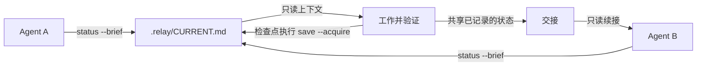

<h1 align="center">Project Continuity</h1>

<p align="center"><strong>一个项目，一份当前状态，跨 Agent 连续工作。</strong></p>

<p align="center">
  面向 Codex、Claude Code、Kimi Code、ZCode、OpenCode 及其他兼容客户端的本地优先项目进度 Skill 与 CLI。
</p>

<p align="center">
  <a href="README.md">English</a> · <a href="README.zh-CN.md">简体中文</a>
</p>

<p align="center">
  <a href="https://github.com/seriousz158/project-continuity/actions/workflows/ci.yml"></a>
  <a href="https://github.com/seriousz158/project-continuity/releases/latest"></a>
  <a href="LICENSE"></a>
  
  
</p>

---

`project-continuity` 把当前目标、任务、阻塞、证据、决策和精确下一步放进一份可审查文件：

```text
.relay/CURRENT.md
```

文件内部由权威的结构化 JSON 和自动生成的 Markdown 视图组成。所有 Agent 读取同一状态；写入经过 revision 校验和 writer lease；正式交接会释放 lease，让下一位 Agent 安全接棒。接力文件接近 64 KiB 上限时，CLI 会在同一锁内无损归档旧操作回执，不会截断项目记录。整个流程不依赖聊天回放、后台服务、数据库、云服务或模型调用。

## 为什么需要它

编码 Agent 能读代码，但聊天记录不是可靠的项目状态：

- 新会话不知道上一次真正完成了什么；
- 普通进度文字可能在没有验收证据时宣称完成；
- 两个 Agent 可能互相覆盖更新；
- 任务完成容易被误解成已经合并、发布、部署或执行实验；
- 多份 checkpoint 会逐渐变成互相竞争的真相源。

Project Continuity 把这些风险变成明确的协议校验，同时保持状态足够小，让人可以直接审查。

## 它维护什么

```text
.relay/
├── CURRENT.md    # 完成切换后，当前项目进度的唯一权威
├── .gitignore    # 默认让运行态保留在本地
├── history/      # 不可覆盖的历史 revision
├── receipts/     # v3+ 内容寻址的回执片段，默认只在本地
├── objects/      # v4+ 内容寻址的证据、正文和冷归档
└── inbox/        # 可选、尚未合并的 Agent 输入
```

`CURRENT.md` 中的结构化对象：

| 对象 | 用途 |
| --- | --- |
| 项目 | 目标、运行状态、当前任务、精确下一步，以及独立的结果字段 |
| 任务 | 稳定 ID、负责人、依赖、验收条件和生命周期状态 |
| 阻塞 | open/resolved 状态，以及明确的解除说明 |
| 证据 | 不可修改的检查记录，关联任务验收和代码基线 |
| 决策 | 不可修改的结论、理由和关联任务 |
| 扩展 | 命名空间隔离的项目专属当前字段 |

任务状态固定为 `todo`、`doing`、`blocked`、`done` 或 `cancelled`。没有覆盖当前 generation 全部验收条件的通过证据，任务不能变成 `done`。

## 工作方式



1. **检查**：默认先用只读的 `status --brief`，查看 `drift` 布尔值、`current_task`、未覆盖验收计数和最近最多三条证据的 ID 与结果。需要 `next_step`、阻塞列表或 Git 基线详情时，直接用完整的 `status` 或 `handoff`。`status` 和 `validate` 都不会隐式初始化项目。
2. **工作并验证**：根据已记录的状态继续工作，不为开工而拿租约。只读续接零写入。
3. **合并变更**：把同一业务事件的任务状态、证据、决策、阻塞和相关 `next_step` 合成一个检查点补丁。保留项目要求的独立检查点，遵守仅手动写入的覆盖规则。不逐条消息写入、不运行 watcher、不做 Git 提交或外部操作。
4. **保存**：`save --acquire` 在写入事务内校验预期 revision 并复查 Git 漂移。如果他人持有有效租约，拒绝写入并指出持有者。保存成功时，在一个 revision 内取得租约、写入并释放：为旧状态创建快照，在同一锁内完成容量治理后再原子替换。
5. **恢复**：只有 lease 已过期或存在受支持的历史修复场景，才允许显式 `recover`。

## 快速开始

在源码目录或完整安装的 Skill 目录中运行脚本：

```bash
# 只有显式 init 才会创建 .relay/
python scripts/write_current.py init --root /path/to/project --name "My Project"

# 只读概览
python scripts/write_current.py status --brief --root /path/to/project

# 可选的只读结构检查
python scripts/write_current.py validate --root /path/to/project
```

使用刚读到的 revision（此处 `init` 后为 0），用一个结构化补丁保存独立检查点：

```bash
python scripts/write_current.py save --acquire --root /path/to/project \
  --writer agent-a --expected-revision 0 --input examples/change.json
```

开局无漂移不代表后续编辑不会引起漂移。如果保存时报告漂移，请检查记录的和当前观测到的 Git 基线，并审查差异。审查后只能由人决定是否使用 `--allow-drift`；Agent 不得自动加上该参数。

只有需要跨步骤持有 Relay 写权时，才用 `resume` → `update` → 普通 `save`。租约协调的是 Relay 写入，不锁定工作区。不要只为拿租约而执行 `resume`，也不要把它作为 `save --acquire` 的前置操作。默认租期为 30 分钟。以下是另一种用法，从新 relay 的 revision 0 开始：

```bash
python scripts/write_current.py resume --root /path/to/project \
  --writer agent-a --expected-revision 0 --operation-id resume-001

python scripts/write_current.py update --root /path/to/project \
  --writer agent-a --expected-revision 1 --operation-id update-001 \
  --input examples/change.json

# 记录下一步并释放租约，同时保持项目为 active
python scripts/write_current.py save --root /path/to/project \
  --writer agent-a --expected-revision 2 --operation-id save-001 --input - <<'JSON'
{"project":{"status":"active","next_step":"Add an empty-input regression case"}}
JSON
```

与 `update` 不同，两种 `save` 都会释放租约；如果补丁未显式设置 `project.status`，还会把 `active` 项目改为 `paused`。

在同一连续上下文中，复用返回的 `revision` 和 `lease_until`。遇到回放时，使用 `current_revision` 和返回的当前 `writer`、`lease_until`，不用回执里的历史 revision。重试同一个 operation ID 时，参数和输入必须完全相同。发生冲突后先读当前状态，确认补丁仍然成立，而不是只换掉预期 revision。

容量会自动治理。新项目从 v6 开始，文档上限 32 KiB。达到上限的 80% 时，旧回执按每批至少 16 条无损写入 `.relay/receipts/`（当前文件保留 16 条）。如果文档仍高于这条线，已完成的任务、已解决的阻塞，以及只与它们相关的证据和决策会移入 `.relay/objects/` 下的无损冷归档；用 `archive --id <记录 ID>` 可以原样取回。回执压缩可以先预览；显式执行时需持有有效租约，并使用当前 revision：

```bash
python scripts/write_current.py compact --root /path/to/project
python scripts/write_current.py compact --apply --root /path/to/project \
  --writer agent-a --expected-revision <n> --operation-id compact-001
```

不带 `--apply` 的 `compact` 完全只读。`resume`、`update` 和 `save` 支持单次 `--no-auto-compact`，但不会绕过硬上限。history 快照和不再被引用的对象不会被自动删除：`gc` 报告可以释放多少空间，`gc --apply`（需持有 lease）删除最新 50 个以外的快照，以及任何保留版本都不再引用的对象。

如需明确地跨客户端传递，可导出并校验受控交接包；history、inbox、锁和备份仍保留在本地：

```bash
python scripts/write_current.py export --root /path/to/project \
  --output /tmp/project-continuity-handoff.zip
python scripts/write_current.py verify --bundle /tmp/project-continuity-handoff.zip
```

迁移、恢复、自定义 lease、标准输入、容量预览和回执压缩见[命令参考](references/commands.md)。

## 常用工作流

| 场景 | 推荐流程 |
| --- | --- |
| 新项目启用接力 | 显式 `init`，然后检查生成的状态 |
| 开始或恢复任务 | `status --brief`；需要详情时直接用完整 `status` 或 `handoff` |
| 记录任务或阻塞变化 | 用 `save --acquire` 写入一个结构化检查点补丁 |
| 交给另一个 Agent | 需要时才保存新检查点（`save --acquire`，或用普通 `save` 结束跨步骤租约）；接棒方只读 |
| 新会话继续 | 只读 `status --brief`；需要下一步和阻塞时直接用 `status` 或 `handoff` |
| 跨步骤持有 Relay 租约 | `resume` → 用 `update` 记录进展 → 普通 `save` 释放租约 |
| 升级已有 relay | 备份 `.relay/` → `migrate --to-latest` dry-run → 审查步骤和源哈希 → 显式 apply |
| 转换 v1 relay | `migrate --to-latest`（或 `migrate`）→ 切换前复核 `mapping_review_required` |
| 查看归档历史 | `archive` 列表，`archive --id <记录 ID>` 原样取回单条 |
| 回收磁盘空间 | `gc` 报告 → 审查 → 持有 lease 时 `gc --apply` |
| 判断证据强度 | `coverage` 每行的 `assurance`；引用能解析到才会 `verified` |
| 中断后修复 | `status` + `validate` → lease 过期后才 `recover` |

## 核心保证

| 保证 | 实现方式 |
| --- | --- |
| 当前进度只有一个权威 | `.relay/CURRENT.md` 中只有一个受控 JSON 区；Markdown 只是派生视图 |
| 不会意外初始化 | 只有显式 `init` 才创建 relay 状态 |
| 陈旧写入不能覆盖新状态 | 每次写入执行 revision compare-and-swap |
| 同时只有一个提交者 | writer lease 加本机操作系统文件锁 |
| 重试安全 | operation ID 与输入哈希形成幂等回执 |
| 完成必须有证据 | 校验验收覆盖和任务 generation |
| 崩溃安全提交 | 旧版本快照、临时文件、同步和原子替换 |
| 协议增长有界 | 达到 80% 容量时回执分批写入内容寻址归档链；v6 还会把已完成记录移入无损冷归档 |
| 验证结论不夸大 | 每条证据引用分级（`claimed` 到 `externally_checked`），只是自述的引用不会被报告为 verified |
| 接棒时识别 Git 漂移 | 分开识别 branch、HEAD、index、tracked bytes、dirty 与 untracked |
| 保守处理输入 | 路径/链接检查、64 KiB 上限和常见秘密扫描 |

这些保护只协调共享同一本地目录的合作进程，不是跨机器分布式锁，也不声称能够对抗具有同等操作系统权限的恶意进程。

## 一个权威，不是一个数据仓库

新项目显式初始化后，`CURRENT.md` 是**当前项目进度**的唯一权威。既有项目在完成字段映射和全部活动读取方切换前，继续保留原业务权威。

历史测试报告、源码、实验产物、发布记录和领域证据继续保存在各自位置。接力文件引用这些证据，而不是复制和吞并所有项目数据。

任务标记为 `done` 不代表已经 merge、release、deploy 或执行外部实验；这些结果必须独立记录。

## 迁移

内置迁移只处理 v1 relay 格式，不会推断任意业务 schema，也不会改写项目 verifier。

```bash
# 预览：零写入
python scripts/write_current.py migrate --root /path/to/project

# 审查预览和精确源哈希后才 apply
python scripts/write_current.py migrate --root /path/to/project --apply \
  --source-sha256 <hash-from-preview> \
  --writer agent-a --expected-revision <n> --operation-id migrate-001
```

Apply 后会设置 `mapping_review_required=true`。项目专属字段映射和读取方切换完成前，状态必须保持 `UNVERIFIED`。切换期间暂停进度写入，禁止同时双写旧权威和新权威。

## 安全边界

Project Continuity 明确不会：

- 捕获或回放完整聊天；
- 启动 watcher、后台扫描、定时任务或模型；
- 执行接力内容中出现的命令；
- 自动 commit、push、merge、release、deploy 或运行外部实验；
- 静默抢占仍然有效的 writer；
- 自动解决 Git 冲突，或简单按更新时间选择真相；
- 把防误写秘密扫描宣传成完整脱敏系统。

运行态默认保存在本地。v2/v3 的内联进展可共享 `CURRENT.md`、有意设置的 ignore 配置及其可达回执段。v4+ 的 CURRENT 只是入口，不能单独交接：优先使用 `export` / `verify` 交接包；选择 Git 共享时，必须一起包含全部可达对象与回执段。不要共享无关历史、inbox、锁或整个 `.relay/`。冲突必须按稳定记录 ID 审查。

Git 指纹最多读取 256 MiB tracked 工作区内容；遇到不支持的链接、submodule、非普通文件、未合并 index 或不可用数据时会失败关闭。依赖换行转换或 clean filter 的仓库可能被保守地报告为 dirty。

## 兼容性

Skill 遵循开放的 [`SKILL.md` Agent Skills 规范](https://agentskills.io/specification)，面向 Codex、Claude Code、Kimi Code、ZCode、OpenCode 以及其他能够发现 Agent Skills 或仓库指令的客户端。不同客户端的发现路径和重新加载行为不同，因此格式校验、客户端发现、脚本调用和真实跨会话行为必须分层验证。

CLI 支持 macOS、Linux、Windows，以及 Python 3.11、3.12、3.13、3.14。GitHub Actions 会运行全部十二种 OS/Python 组合。

## 安装

从[最新 Release](https://github.com/seriousz158/project-continuity/releases/latest)下载完整压缩包，或克隆仓库：

```bash
git clone https://github.com/seriousz158/project-continuity.git
cd project-continuity
python scripts/write_current.py --help
```

将**完整的** `project-continuity` 目录复制到客户端实际使用的 Skill 目录；不要只复制 `SKILL.md` 或入口脚本。若已存在旧安装，先检查并完整备份，再决定是否替换。仅在安全时重载或重启客户端，随后分别验证 Skill 发现，并从安装目录运行测试。

## 验证情况

`v0.6.0` 包含 287 项测试，覆盖 v6 冷归档及其无损迁移、回执分批、垃圾回收、证据分级、历史重试、存储故障注入和干净发行包运行。
[CI 矩阵](https://github.com/seriousz158/project-continuity/actions/workflows/ci.yml)
覆盖 macOS、Linux、Windows × Python 3.11–3.14；具体提交的结果见 Release Notes。
私有历史快照容量演练保留了项目记录与自定义正文，没有应用待处理业务补丁，也不代表真实项目切换。
客户端发现、脚本运行和实际模型会话加载分别验收，不相互替代。

```bash
python -m unittest discover -s tests -v
python scripts/package_skill.py /tmp/project-continuity-v0.6.0.zip
```

确定性打包器只包含 allowlist 文件，同时生成 SHA-256 sidecar；如果压缩包或校验文件已存在，它会拒绝覆盖。

## 文档

- [命令参考](references/commands.md)
- [协议与数据模型](references/protocol.md)
- [English README](README.md)
- [变更日志](CHANGELOG.md)
- [安全策略](SECURITY.md)
- [贡献指南](CONTRIBUTING.md)

## 项目状态

- 最新稳定版本：[`v0.2.0`](https://github.com/seriousz158/project-continuity/releases/tag/v0.2.0)
- 运行依赖：仅 Python 标准库
- 默认模式：本地、显式、没有后台服务
- 许可证：[MIT](LICENSE)

Copyright (c) 2026 seriousz158。[NOTICE](NOTICE) 保留了受 `liu676767/codex-project-checkpoint-memory` 影响部分的适用署名。


## v0.6 低成本会话

开局用 `status --brief`；单处修改可用 `save --acquire --writer <id>
--expected-revision <n> --input change.json`，获取与释放租约只提交一个 revision。
`capacity --acquire` 可以只读预览同样的单次保存。
resume/update/save 未提供 operation-id 时复用现有回执指纹生成稳定 ID；
显式 ID 优先，重试须保持全部参数相同。后续写入复用返回 revision；
回放使用 current_revision，不能使用历史回执 revision。其他写入的显式 ID
要求不变。brief 只减少输出量，不减少完整性读取，也不替代完成门禁。
容量、墓碑和历史提示从不自动归档或删除。客户端自动发现尚需单独实测；
12 个 CI job 是配置目标，不代表未推送的版本已经远端通过。
